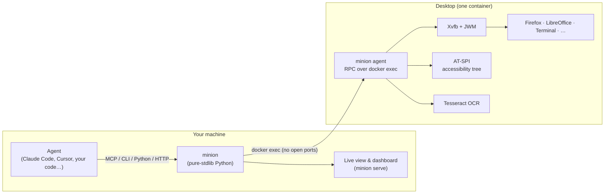

<p align="center">
  
</p>

<h3 align="center">Give every AI agent its own computer.</h3>

<p align="center">
  Featherweight Linux desktops (office, dev, research, browser, data) that agents create in about 1.5 seconds<br>
  and drive through <b>MCP</b>, a <b>CLI</b>, <b>Python</b>, <b>HTTP</b> or <b>Claude computer use</b>. Agents read the screen as text, and humans can watch and take over.
</p>

<p align="center">
  <a href="https://pypi.org/project/minion-desktop/"></a>
  <a href="https://github.com/apophisss/minion/actions/workflows/ci.yml"></a>
  
  
  
  <a href="LICENSE"></a>
</p>

```bash
pipx install minion-desktop        # or: uv tool install minion-desktop   (needs Docker)
minion up office                   # a full office desktop, ready in ~1.5 s
minion open writer                 # LibreOffice Writer opens
minion see                         # the screen as text: every control has an @id
minion click "Bold" && minion type "Hello from an agent"
minion view                        # watch it live in your browser
```

<p align="center"></p>
<p align="center"><sub>An agent on a <code>research</code> desktop. The GIF was made by Minion's built-in flight recorder (<code>minion replay -o demo.gif</code>).</sub></p>

---

## Why Minion

- **🧠 Agents read the screen as text.** `see` turns any window into a numbered list of controls taken from the accessibility tree, with OCR as a fallback: `@12 button "Save" (210,62)`. The text is exact and every control is clickable by `@id`. A terminal comes out as about 50 tokens instead of a 1,365-token screenshot. Screenshots are still there when the agent needs to look, including a *marks* mode that draws the `@ids` onto the image.
- **🪶 Featherweight.** Each desktop is a single container running Xvfb, a 1 MB window manager and a tiny agent. There is no desktop environment, VNC server or browser bundle. Desktops are ready in about 1.5 s and use 55–105 MB of RAM when idle. Desktops nobody is using are frozen automatically (0% CPU) and wake in about 0.2 s on the next call.
- **🎯 Desktops tuned for agents.** First-run wizards, tips-of-the-day, donation bars and crash-recovery dialogs are all turned off. Cookie banners and ads are blocked. Downloads land in `~/Downloads` without a dialog, Office saves `.docx`/`.xlsx`/`.pptx` by default, and animations and blinking carets are off so screenshots are stable.
- **🔌 Works with every agent stack.** Minion includes an MCP server for Claude Code, Claude Desktop, Cursor, VS Code, Codex, Gemini CLI and others. It also has a shell-friendly CLI, a Python SDK, an HTTP API, and a ready-made driver for **Claude's computer-use toolset**.
- **🙋 Humans in the loop.** Every desktop has a live view in the browser with one-click *take control*. Agents can **hand off** to a person ("please sign in") and wait until they press *Done*.
- **🎞️ Flight recorder.** Every action is kept with a thumbnail. Export it as an HTML timeline or a GIF to see exactly what your agent did.
- **🌿 Fork, snapshot, restore.** Clone a desktop before a risky step, explore in parallel, and roll back.
- **📦 Zero dependencies.** The host side is pure Python standard library. Desktops run in Docker or Podman (macOS, Windows, Linux), or natively on Linux without Docker.

## Quick start

**1. Install** (needs Python 3.11+ and [Docker](https://docs.docker.com/get-docker/), or Podman):

```bash
pipx install minion-desktop          # or: uv tool install minion-desktop / pip install minion-desktop
minion doctor                        # checks your setup
```

The first desktop of each profile downloads its image (188–700 MB, shared layers). To fetch images ahead of time, run `minion pull office research`.

**2. Connect your agent.** The fastest way is MCP:

```bash
claude mcp add minion -- uvx minion-desktop mcp          # Claude Code
```

<details>
<summary><b>Claude Desktop, Cursor, VS Code, Windsurf, Codex, Gemini CLI, …</b></summary>

Most clients take the same JSON (Claude Desktop: `claude_desktop_config.json`, Cursor: `~/.cursor/mcp.json`, Windsurf: `~/.codeium/windsurf/mcp_config.json`, Gemini CLI: `~/.gemini/settings.json`):

```json
{ "mcpServers": { "minion": { "command": "uvx", "args": ["minion-desktop", "mcp"] } } }
```

VS Code (`.vscode/mcp.json`):

```json
{ "servers": { "minion": { "type": "stdio", "command": "uvx", "args": ["minion-desktop", "mcp"] } } }
```

OpenAI Codex CLI (`~/.codex/config.toml`):

```toml
[mcp_servers.minion]
command = "uvx"
args = ["minion-desktop", "mcp"]
```

If Minion is already installed, use `"command": "minion", "args": ["mcp"]`. More detail is in [docs/agents.md](docs/agents.md).
</details>

Then just ask: *"Create an office desktop, write a one-page brief about our Q3 numbers in Writer and save it as brief.docx."* The agent gets 8 tools: `desktop`, `see`, `screenshot`, `act`, `open`, `run`, `files` and `view`.

**3. Or drive it yourself.** Any agent with a shell (Claude Code, Codex, Aider, your scripts) can use the CLI directly:

```bash
minion up research
minion open "en.wikipedia.org"
minion fill "Search Wikipedia" "Ada Lovelace" && minion key Return
minion wait-for "Analytical Engine"
minion see --full                       # read the article as text
minion shot -o page.png --marks         # a screenshot with @ids drawn on it
minion run "pdftotext -layout ~/Downloads/paper.pdf - | head"
minion cp :~/Documents/notes.md .       # copy files out (and in)
```

## Python

```python
from minion import Desktop

with Desktop.create("office", keep=False) as desk:  # removed when the block ends
    desk.open("calc")
    desk.act("type 'Revenue'", "key Tab", "type 1200", "key Return")
    print(desk.see())  # the sheet and the UI as text
    desk.key("ctrl+s")
    desk.fill("Name", "q3.xlsx")
    desk.key("Return")
    desk.wait_for("q3.xlsx")  # the title changes once it's saved
    desk.download("~/Documents/q3.xlsx", ".")
```

The `Desktop` API covers it all: `screenshot · see · find · act · click · type · key · scroll · drag · fill · wait_for · open · run · upload · download · clipboard · windows · freeze · fork · snapshot · restore · recording`. See [docs/python.md](docs/python.md).

## Claude computer use

Minion includes a driver for Claude's `computer_toolset_20260801` (all 17 actions, `zoom` included). It also supports the earlier `computer_20251124` tool, and it scales screenshots and coordinates for you:

```python
import anthropic
from minion import Desktop
from minion.integrations.anthropic import MinionComputer, allow_all

desk = Desktop.create("office")
with MinionComputer(desk, confirm=allow_all) as computer:  # the desktop is the sandbox
    runner = anthropic.Anthropic().beta.messages.tool_runner(
        model="claude-opus-5-5",
        max_tokens=4096,
        tools=[computer],
        messages=[{"role": "user", "content": "Make a 3-slide deck about otters in Impress."}],
    )
    for message in runner:
        print(message)
```

Not using the SDK helpers? Use `ComputerUse(desk)`: it gives you the `tools` entry and turns Claude's `tool_use` blocks into `tool_result` blocks. See [docs/computer-use.md](docs/computer-use.md).

## Profiles

| Profile | What's inside | Download | Idle RAM |
|---|---|---|---|
| 🌐 `browser` | Firefox with uBlock Origin (ads, trackers, cookie banners, newsletter pop-ups), downloads straight to `~/Downloads` | 352 MB | ~55–100 MB |
| 📄 `office` | LibreOffice Writer, Calc, Impress + text editor + file manager + Firefox. Saves Microsoft formats by default | 511 MB | ~85 MB |
| 🛠️ `dev` | git, Python, Node.js, build tools, Geany IDE, a real terminal (readable by `see`), Firefox + Chromium | 703 MB | ~55 MB |
| 🔎 `research` | Firefox + `pdftotext`, `pandoc`, a notes editor, Python with requests and BeautifulSoup | 410 MB | ~55 MB |
| 📊 `data` | `office` + pandas, NumPy, SciPy, matplotlib, seaborn, openpyxl, SQLite | 662 MB | ~105 MB |
| 🧩 `base` | X server, window manager, terminal and the agent. The foundation to build on | 188 MB | ~65 MB |

**Your own profile** is a 5-line TOML file in `~/.config/minion/profiles/`. It is built automatically the first time you use it:

```toml
# ~/.config/minion/profiles/designer.toml
extends = "browser"
description = "Firefox plus GIMP and Inkscape."
packages = ["gimp", "inkscape"]
apps = [{ name = "GIMP", command = "gimp" }, { name = "Inkscape", command = "inkscape" }]
```

`minion up designer`, and that's all. See [docs/profiles.md](docs/profiles.md).

## How agents see the screen

`see` is the agent's main sense. Here it is on a LibreOffice window, as plain text the model can read and act on:

```text
Screen 1280x800 · 1 window
  [1] "Untitled 1 — LibreOffice Writer" — libreoffice-writer (focused) at 0,0 1280x770

UI of "Untitled 1 — LibreOffice Writer" (click/fill with @id; (x,y) is the element center):
@1 menu "File" (22,38)
@2 menu "Edit" (62,38)
…
@12 document text "Untitled 1 - LibreOffice Document" [editable] (603,424)
  @13 heading "Q3 Market Brief" (603,247)
  @14 paragraph "Prepared by an AI agent on a Minion desktop. No human touched the keyboard." (603,282)
  @15 paragraph "Revenue grew 42% quarter over quarter, driven by agent-operated workflows." (603,340)
```

Targets can be an `@id`, visible text (`"Save"`, `"Sign in"`), or pixels (`640,400`). After every action Minion waits for the screen to settle and reports what changed:

```text
✓ click button "Save" (1142,744)
→ screen changed 8% (region 0,0 1280x800) · closed "Save As" · focused "report.docx — LibreOffice Writer"
```

When a model needs pixels, `screenshot --marks` labels every control with its `@id`:

<p align="center"></p>

## Watch, take over, hand off

`minion view` (or the `view` MCP tool) opens a live view of any desktop in your browser. Click **Take control** to use your own mouse and keyboard. An agent can call `view(message="Please sign in to your Google account")`: you get a banner, sign in, press **Done**, and the agent continues. `minion serve` adds a dashboard of all desktops with live thumbnails:

<p align="center"></p>

## Benchmarks

These were measured on a 2-vCPU cloud VM with Docker 29 and can be reproduced with `python scripts/bench.py`. RAM is what `docker stats` reports (it includes the page cache).

| Profile | Download | Ready in | Idle RAM | RAM with its main app | `see` | Screenshot |
|---|---|---|---|---|---|---|
| base | 188 MB | 1.5 s | 66 MB | 94 MB (terminal) | ~50 tokens | ~1,365 tokens |
| browser | 352 MB | 1.2–1.8 s | 54–102 MB | 830–900 MB (Firefox on Wikipedia) | ~1,090 tokens | ~1,365 tokens |
| office | 511 MB | 1.6 s | 86 MB | 409 MB (Writer) | ~1,000 tokens | ~1,365 tokens |
| dev | 703 MB | 1.3 s | 55 MB | 103 MB (terminal) | ~90 tokens | ~1,365 tokens |
| research | 410 MB | 1.4 s | 54 MB | 775 MB (Firefox on arXiv) | ~1,580 tokens | ~1,365 tokens |
| data | 662 MB | 1.5 s | 105 MB | 367 MB (Calc) | ~1,130 tokens | ~1,365 tokens |

Frozen desktops measured **0.00% CPU**. Opening an app takes 0.8–4 s (LibreOffice ≈ 2.7 s, Firefox page ≈ 4 s). `see` costs fewer tokens than a 1280×800 screenshot for terminals and most apps, and about the same on busy web pages. Every time, it gives exact text and clickable ids.

## How it works



- **No ports, no VNC.** The host talks to the in-desktop agent over `docker exec`, so the same code path works with Docker Desktop, remote `DOCKER_HOST`s and Podman. The live view streams compressed frames only while someone is watching.
- **Host and desktop always match.** The agent code is copied into each desktop when it is created, so upgrading Minion never strands old images.
- **Plain Debian inside.** Agents can `sudo apt-get install` anything (`run` tool), and every profile is an ordinary Docker image.

More in [docs/architecture.md](docs/architecture.md).

## Security

Each desktop is an unprivileged container with no host mounts by default. Use `--offline` to cut network access, or limit resources with `--memory` and `--cpus`. The HTTP server binds to `127.0.0.1` and needs a random token. The desktop user has passwordless `sudo` **inside** the container, because agents need to install tools. Treat everything on a screen as untrusted input: web pages can attempt prompt injection. Keep credentials out of desktops unless a human hands off. Read [SECURITY.md](SECURITY.md).

## Documentation

[Agents & MCP](docs/agents.md) · [CLI](docs/cli.md) · [Python](docs/python.md) · [HTTP API](docs/http-api.md) · [Claude computer use](docs/computer-use.md) · [Profiles](docs/profiles.md) · [Architecture](docs/architecture.md) · [FAQ](docs/faq.md)

## Contributing

Issues and pull requests are welcome. See [CONTRIBUTING.md](CONTRIBUTING.md). Good first contributions include new profiles (`minion/profiles/*.toml`), better `see` output for specific apps, and MCP client recipes.

## License

[MIT](LICENSE). The desktops contain open-source software under their own licenses (Debian, Firefox, LibreOffice, …).
