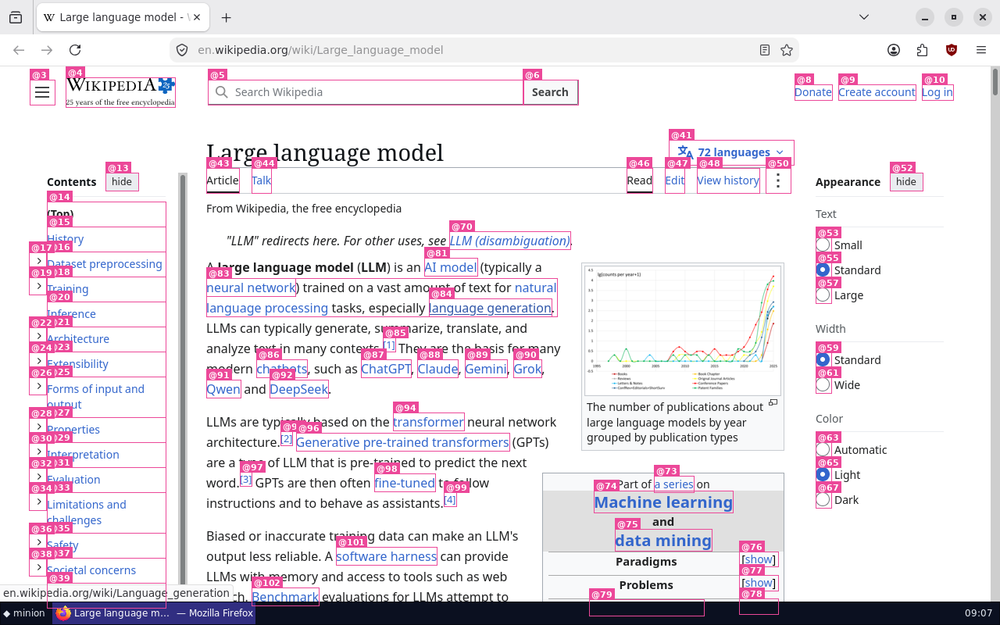
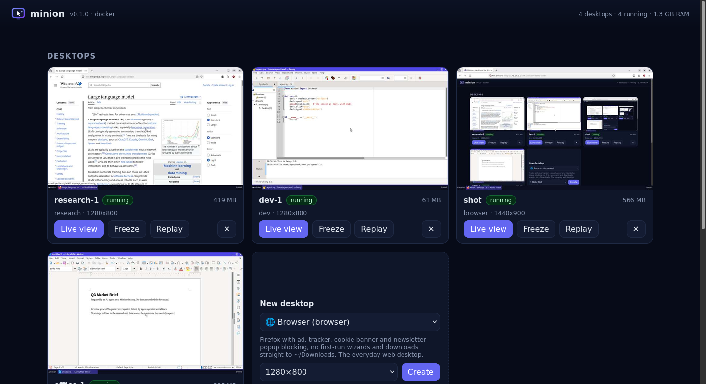
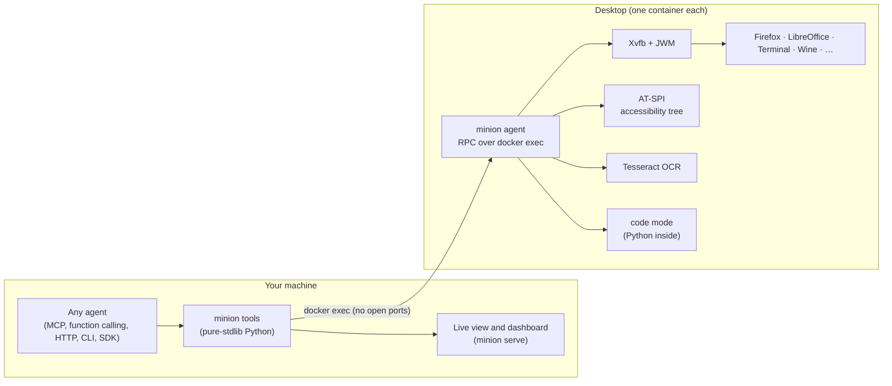

<p align="center">
  
</p>

<h3 align="center">Give every AI agent its own computer.</h3>

<p align="center">
  Featherweight Linux desktops (office, dev, research, browser, data, Windows apps) that any agent can use:<br>
  Claude, ChatGPT, Gemini, Cursor, VS Code, LangChain, your own code, or a model running on your laptop.<br>
  Agents read the screen as text, act in batches or in code, and use any program or website.
</p>

<p align="center">
  <a href="https://pypi.org/project/minion-desktop/"></a>
  <a href="https://github.com/apophisss/minion/actions/workflows/ci.yml"></a>
  
  
  
  <a href="LICENSE"></a>
</p>

<p align="center">English · <a href="README.zh-CN.md">简体中文</a> · <a href="README.zh-TW.md">繁體中文</a> · <a href="README.ko.md">한국어</a> · <a href="README.ja.md">日本語</a> · <a href="README.he.md">עברית</a></p>

<!-- mcp-name: io.github.Apophisss/minion -->

## Get started

All you need is [Docker](https://docs.docker.com/get-docker/) (or OrbStack or Podman). Then pick one:

**1. One click** in your AI app:

[](https://github.com/apophisss/minion/releases/latest/download/minion.mcpb)
[](https://insiders.vscode.dev/redirect/mcp/install?name=minion&config=%7B%22command%22%3A%22uvx%22%2C%22args%22%3A%5B%22minion-desktop%22%2C%22mcp%22%5D%7D)
[](https://cursor.com/install-mcp?name=minion&config=eyJjb21tYW5kIjoidXZ4IiwiYXJncyI6WyJtaW5pb24tZGVza3RvcCIsIm1jcCJdfQ%3D%3D)
[](https://vs-open.link/mcp-install?%7B%22name%22%3A%22minion%22%2C%22command%22%3A%22uvx%22%2C%22args%22%3A%5B%22minion-desktop%22%2C%22mcp%22%5D%7D)
[](https://lmstudio.ai/install-mcp?name=minion&config=eyJjb21tYW5kIjoidXZ4IiwiYXJncyI6WyJtaW5pb24tZGVza3RvcCIsIm1jcCJdfQ%3D%3D)
[](https://goose-docs.ai/extension?cmd=uvx&arg=minion-desktop&arg=mcp&timeout=900&id=minion&name=Minion&description=Linux%20desktops%20that%20agents%20read%20as%20text%20and%20control)
[](https://kiro.dev/launch/mcp/add?name=minion&config=%7B%22command%22%3A%22uvx%22%2C%22args%22%3A%5B%22minion-desktop%22%2C%22mcp%22%5D%7D)

Claude Code: `claude plugin marketplace add apophisss/minion && claude plugin install minion@minion`. Any other MCP
client: `uvx minion-desktop mcp`, or `npx -y minion-desktop mcp`. The buttons, uvx and npx start Minion with
[uv](https://docs.astral.sh/uv/) (npx can use pipx instead); the Claude Desktop extension needs nothing else.

**2. One line** that installs Minion and connects every AI app on your computer (Claude Desktop, Claude Code,
Cursor, VS Code, Windsurf/Devin, Gemini CLI, Codex, LM Studio, Cline, Kiro):

```bash
curl -fsSL https://raw.githubusercontent.com/apophisss/minion/main/install.sh | sh        # macOS, Linux
```

```powershell
irm https://raw.githubusercontent.com/apophisss/minion/main/install.ps1 | iex             # Windows
```

It ends with `minion setup`, which checks Docker, prepares a desktop and runs `minion connect`. Run either one again
any time.

**3. From ChatGPT, Claude.ai or Le Chat** in the browser: run `minion share` and paste the URL it prints into the
app's connector settings ([how](docs/remote.md)).

Then just ask: *"Create an office desktop, write a one-page brief about our Q3 numbers in Writer and save it as
brief.docx."* Every way to install is in [docs/install.md](docs/install.md).

<p align="center"></p>
<p align="center"><sub>An agent on a <code>research</code> desktop. The GIF was made by Minion's built-in flight recorder (<code>minion replay -o demo.gif</code>).</sub></p>

---

## Why Minion

- **🖥️ Any program, any website.** Every desktop is a real Linux computer: browsers, LibreOffice, IDEs, terminals,
  file dialogs and installers, plus Windows programs through the `windows` (Wine) profile. **Open any app by name**
  and it is installed the first time (`open gimp`, `open vscode`, `open dbeaver`, any Debian package), web apps open
  in the browser (`open gmail`), and the first open answers with a few tips for the app.
- **🧭 Shortcuts through every app.** `see --menus` lists every menu command with its keyboard shortcut, and
  `menu "File > Export as PDF"` runs one without opening a menu. `path ~/out.pdf` fills any Open/Save dialog.
  Right-click menus show up in `see`, `button:Save` picks one kind of control, and a button below the fold is
  scrolled into view. **Any document reads as text** (`read report.docx`, xlsx with formulas, pptx, pdf) and
  converts in one call (`convert report.docx pdf`).
- **🧠 Agents read the screen as text.** `see` turns any window into a list of controls with **stable `@ids`**, taken
  from the accessibility tree with OCR as a fallback: `@12 button "Save" (210,62)`. Web pages, editors (with line
  numbers), terminals, dropdowns with their options, and spreadsheets (`A1: value`) all come out as exact text.
  When pixels matter, screenshots can draw the `@ids` for you.
- **🎯 Honest actions.** Every action waits for the screen to settle (and for web pages to load) and reports what
  changed. Text targets must really be on screen: a miss fails with the closest candidates instead of clicking
  something else.
- **🪙 Built to save tokens.** You get diffs instead of re-reads (`see(changes=true)`: about 60 tokens instead of
  about 900). **Code mode** runs a 50-step GUI loop in one call, crops and half-size screenshots cut image cost,
  a **compact mode** shrinks the tool definitions from about 2,100 tokens to 230, and the Agent Skill costs about
  100 tokens until it is used.
- **🪶 Featherweight.** One small container per desktop (Xvfb, a 2-process window manager and taskbar, a small agent),
  with no VNC and no desktop environment. Desktops are ready in about 1.5 s and use about 60 MB when idle. Idle
  desktops are frozen automatically (0% CPU) and wake in about 0.2 s.
- **🔌 Works with every agent.** One toolset everywhere: MCP (local or remote), function calling for OpenAI,
  Anthropic, Gemini and local models, HTTP with OpenAPI, a CLI and an Agent Skill for shell agents, Python and
  TypeScript SDKs, and native adapters for **Claude, OpenAI and Gemini computer use**.
- **⚡ Parallel by design.** `create count=8` starts a desktop per worker, `fork` clones one before a risky step,
  and sessions keep agents apart.
- **🙋 Humans in the loop.** A live view in the browser offers one-click *take control*. Agents can **hand off**
  ("please sign in") and wait for *Done*.
- **🎞️ Teach once, replay forever.** Every action is recorded. Export an HTML timeline or GIF, or turn the session
  into a **Python script that replays it with no model at all**.
- **📦 Zero dependencies.** The host side is pure Python standard library. Desktops run in Docker or Podman
  (macOS, Windows, Linux), or natively on Linux.

## A quick tour from the shell

Any agent with a terminal (Claude Code, Codex CLI, Aider, Open Interpreter, Goose) can use the CLI directly, and
`minion skill --install` teaches it how:

```bash
minion up research
minion open en.wikipedia.org             # waits until the page has loaded
minion fill "Search Wikipedia" "Ada Lovelace" && minion key Return
minion wait-for "Analytical Engine"      # says where it saw the text
minion see --full                        # read the article as text
minion select @14 "Title"                # pick a dropdown option
minion shot -o page.png --marks          # a screenshot with @ids drawn on it
minion read ~/Downloads/paper.pdf         # any document as text: pdf, docx, xlsx, pptx, epub...
minion open gimp                          # any app by name: installed the first time
minion menu "File > Export As > Export as PDF..."   # any menu command
minion path ~/Documents/report.pdf        # fill the open Save/Open dialog
minion cp :~/Documents/notes.md .        # copy files out (and in)
```

## Works with every agent

| Your agent | Connect with |
|---|---|
| Claude Desktop/Code, Cursor, VS Code, Codex, Gemini CLI, Windsurf/Devin, LM Studio, Kiro, Goose | one click, `minion connect`, or `uvx minion-desktop mcp` ([install](docs/install.md)) |
| Agent frameworks: OpenAI Agents SDK, LangChain/LangGraph, LlamaIndex, CrewAI, smolagents, Pydantic AI, Google ADK, AutoGen | the same MCP server ([verified recipes](docs/integrations.md)) |
| ChatGPT, Claude.ai, Le Chat (web apps) | `minion share`: remote MCP over HTTPS ([docs](docs/remote.md)) |
| Any model with function calling (OpenAI, Anthropic, Gemini, Mistral, local models via Ollama/vLLM) | `Toolkit().definitions("openai" \| "anthropic" \| "gemini")` + `Toolkit().run_calls()` ([docs](docs/agents.md#without-mcp-function-calling-with-any-model)) |
| Anything that speaks HTTP (n8n, Dify, GPT Actions, any language) | `minion serve` → `/api/tools/*`, `/mcp` and `/openapi.json` ([docs](docs/http-api.md)) |
| Shell agents | the `minion` CLI ([docs](docs/cli.md)) and its [Agent Skill](https://agentskills.io) (`minion skill --install`) |
| Python / TypeScript code | `from minion import Desktop` ([docs](docs/python.md)) · [`clients/typescript`](clients/typescript) |
| Native computer-use models | Claude toolset ([docs](docs/computer-use.md)) · OpenAI and Gemini computer use ([docs](docs/computer-use-openai-gemini.md)) |

A complete agent with **any** OpenAI-compatible model (`"anthropic"`, `"gemini"` and `"openai-responses"` work
the same way):

```python
from openai import OpenAI
from minion.tools import Toolkit

tk = Toolkit()
client = OpenAI()  # or OpenAI(base_url="http://localhost:11434/v1", api_key="ollama") for a local model
messages = [{"role": "user", "content": "On a research desktop, find the population of Iceland on Wikipedia."}]
while True:
    msg = (
        client.chat.completions.create(model="YOUR-MODEL", messages=messages, tools=tk.definitions("openai"))
        .choices[0]
        .message
    )
    messages.append(msg)
    if not msg.tool_calls:
        break
    messages += tk.run_calls(msg.tool_calls)  # runs every call, returns the messages to send back
print(msg.content)
```

## Python, and code mode

```python
from minion import Desktop

with Desktop.create("office", keep=False) as desk:  # removed when the block ends
    desk.open("calc")
    result = desk.script("""
for item, price in [("Coffee", 3.5), ("Bagel", 2.25), ("Juice", 4)]:
    write(f"{item}\\t{price}\\n")             # Tab moves right, Return goes down
write("Total\\t=SUM(B1:B3)\\n")
print(cells()["B4"])                          # visible cells as {"A1": ...}
""")
    print(result.stdout)  # 9.75
    desk.key("ctrl+s")
    desk.fill("Name", "q3.xlsx")
    desk.key("Return")
    desk.wait_for("q3.xlsx")
    desk.download("~/Documents/q3.xlsx", ".")
```

`script` runs Python **inside** the desktop with `click · write · key · scroll · fill · see · elements · cells ·
wait_for · launch · run`. Loops cost one call, and only what the code prints comes back. The `Desktop` API also
has `screenshot · see · act · open · run · upload · download · clipboard · windows · freeze · fork · snapshot ·
restore · recording · create_many`. See [docs/python.md](docs/python.md).

## Native computer use (Claude, OpenAI, Gemini)

Minion is a ready environment for each vendor's computer-use model, with screenshot scaling and coordinate mapping
handled for you:

```python
import anthropic
from minion import Desktop
from minion.integrations.anthropic import MinionComputer, allow_all

desk = Desktop.create("office")
with MinionComputer(desk, confirm=allow_all) as computer:  # the desktop is the sandbox
    runner = anthropic.Anthropic().beta.messages.tool_runner(
        model="claude-opus-5-5",
        max_tokens=16000,
        tools=[computer],
        messages=[{"role": "user", "content": "Make a 3-slide deck about otters in Impress."}],
    )
    for message in runner:
        print(message)
```

Claude's `computer_toolset_20260801` (all 17 actions) and the earlier `computer_20251124` are covered in
[docs/computer-use.md](docs/computer-use.md). OpenAI and Gemini computer use are covered in
[docs/computer-use-openai-gemini.md](docs/computer-use-openai-gemini.md).

## Profiles

| Profile | What's inside | Download | Idle RAM |
|---|---|---|---|
| 🌐 `browser` | Firefox with uBlock Origin (ads, trackers, cookie banners, newsletter pop-ups), downloads straight to `~/Downloads`, a terminal `see` can read | 352 MB | ~55–100 MB |
| 📄 `office` | LibreOffice Writer, Calc, Impress + text editor + file manager + Firefox + PDF tools. Saves Microsoft formats by default, and types exactly what the agent sends (no AutoCorrect) | 511 MB | ~85 MB |
| 🛠️ `dev` | git, Python, Node.js, build tools, Geany IDE, a real terminal (readable by `see`), Firefox + Chromium | 703 MB | ~55 MB |
| 🔎 `research` | Firefox + `pdftotext`, `pandoc`, a notes editor, Python with requests and BeautifulSoup | 410 MB | ~55 MB |
| 📊 `data` | `office` + pandas, NumPy, SciPy, matplotlib, seaborn, openpyxl, SQLite | 663 MB | ~105 MB |
| 🪟 `windows` | Wine 10 for 64- and 32-bit Windows `.exe`/`.msi` programs, plus Firefox to download them. x86-64 hosts ([docs](docs/windows-apps.md)) | 707 MB | ~56 MB (~270 MB with a program open) |
| 🧩 `base` | X server, window manager, terminal and the agent. The foundation to build on | 187 MB | ~65 MB |

**Your own profile** is a 5-line TOML file in `~/.config/minion/profiles/`. It is built automatically the first time you use it:

```toml
# ~/.config/minion/profiles/designer.toml
extends = "browser"
description = "Firefox plus GIMP and Inkscape."
packages = ["gimp", "inkscape"]
apps = [{ name = "GIMP", command = "gimp" }, { name = "Inkscape", command = "inkscape" }]
```

Or add software at runtime: `minion run "minion-install gimp https://example.com/tool.AppImage pip:yt-dlp"`.
See [docs/profiles.md](docs/profiles.md).

## How agents see the screen

`see` is the agent's main sense. Here it is on a LibreOffice window:

```text
Screen 1280x800 · 1 window
  [1] "Untitled 1 — LibreOffice Writer" — libreoffice-writer (focused) at 0,0 1280x770

UI of "Untitled 1 — LibreOffice Writer" (click/fill with @id; (x,y) is the element center):
@1 menu "File" (22,38)
@2 menu "Edit" (62,38)
…
@12 document text "Untitled 1 - LibreOffice Document" [editable] (603,424)
  @13 heading "Q3 Market Brief" (603,247)
  @14 paragraph "Prepared by an AI agent on a Minion desktop. No human touched the keyboard." (603,282)
```

After an action, `observe="changes"` (or `see(changes=true)`) returns only the difference:

```text
✓ typed 30 chars
→ screen changed <1% (region 404,226 236x20)
Changes since your last look 1.0s ago (81 elements unchanged; their @ids still work):
  + @84 paragraph "Quarterly numbers look strong." [focused] (603,234)
  ~ @80 label "4 words, 30 characters" (281,730)
```

When pixels matter, `screenshot --marks` labels every control with its `@id`:

<p align="center"></p>

## Efficiency, measured

| | Tokens | |
|---|---|---|
| Screenshot 1280×800 | ~1,365 | the baseline |
| `screenshot(detail="low")` | ~341 | half size |
| `act(observe="crop")`, only the changed region | ~200 | |
| `see` of a LibreOffice window | ~920 | exact text plus clickable ids |
| `see(changes=true)` after typing a sentence | **~60** | stable ids, diff only |
| `see` of a terminal | ~50–90 | |
| Tool definitions: 9 tools / compact `computer` | ~2,100 / **~230** | sent with every request |
| 5 rows of spreadsheet entry: `act` ×5 / `script` ×1 | 5 calls / **1 call** | no model round trip per step |

| Resources | |
|---|---|
| Ready in | 1.2–1.8 s (every profile) |
| Idle RAM | 54–105 MB per desktop (Firefox/LibreOffice add their own when open) |
| Frozen | 0.00% CPU, thawed in ~0.2 s on the next call |
| 3 desktops in parallel | 3.0 s |

These were measured on a 2-vCPU VM. Reproduce them with `python scripts/bench.py`.

## Watch, take over, hand off

`minion view` (or the `view` tool) opens a live view of any desktop in your browser. Click **Take control** to use
your own mouse and keyboard. An agent can call `view(message="Please sign in to your Google account")`: you get a
banner, sign in, press **Done**, and the agent continues. A good pattern is to log in once, `snapshot`, then `fork`
the logged-in desktop for each task. `minion serve` adds a dashboard with live thumbnails:

<p align="center"></p>

## How it works



Read [docs/design.md](docs/design.md) for the reasoning behind each choice, and [docs/architecture.md](docs/architecture.md) for the internals.

## Security

Each desktop is an unprivileged container with no host mounts by default. Use `--offline` to cut network access,
or limit resources with `--memory` and `--cpus`. The HTTP server binds to `127.0.0.1`, needs a random token, and refuses
cross-site and DNS-rebinding requests. File transfers to and from your computer stay inside one folder, and `minion
share` URLs carry a fresh token and stop working when you stop sharing. The desktop user has passwordless `sudo` **inside** the container, so agents
can install software. Treat everything on a screen as untrusted input (prompt injection), and keep credentials
out of desktops unless a human hands off. Read [SECURITY.md](SECURITY.md).

## Documentation

[Website](https://apophisss.github.io/minion/) · [Install](docs/install.md) · [Connect your apps](docs/connect.md) · [Remote MCP](docs/remote.md) · [Design](docs/design.md) · [Agents & MCP](docs/agents.md) · [Integrations](docs/integrations.md) · [CLI](docs/cli.md) · [Python](docs/python.md) · [HTTP API](docs/http-api.md) · [Claude computer use](docs/computer-use.md) · [OpenAI & Gemini computer use](docs/computer-use-openai-gemini.md) · [Profiles](docs/profiles.md) · [Windows apps](docs/windows-apps.md) · [Architecture](docs/architecture.md) · [FAQ](docs/faq.md)

## Contributing

Issues and pull requests are welcome. See [CONTRIBUTING.md](CONTRIBUTING.md). Good first contributions include new
profiles (`minion/profiles/*.toml`), better `see` output for specific apps, and integration recipes.

## License

[MIT](LICENSE). The desktops contain open-source software under their own licenses (Debian, Firefox, LibreOffice, Wine, …).
