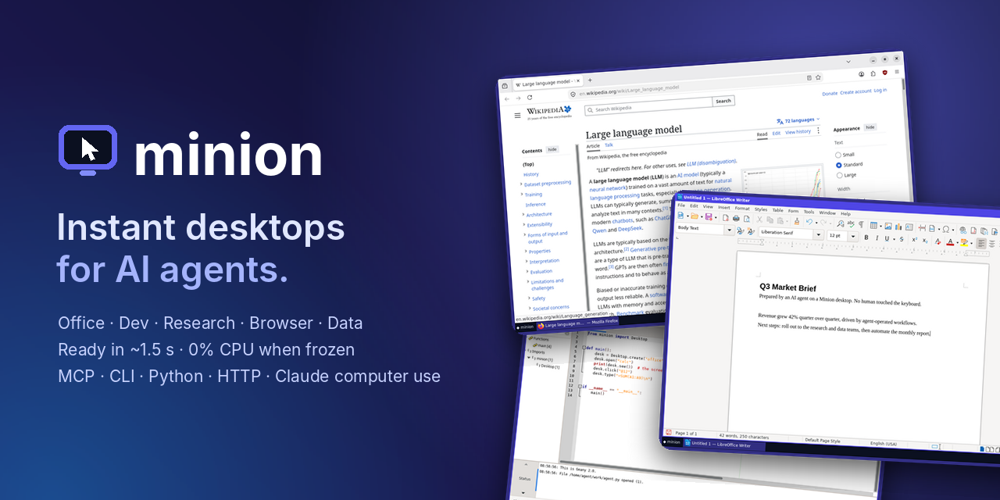
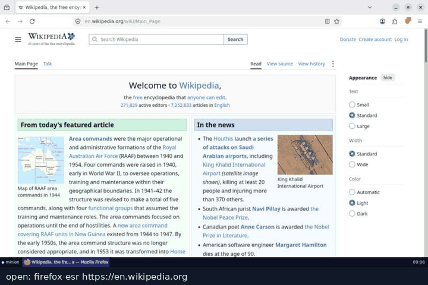

<p align="center"><a href="README.md">English</a> · 简体中文 · <a href="README.zh-TW.md">繁體中文</a> · <a href="README.ko.md">한국어</a> · <a href="README.ja.md">日本語</a> · <a href="README.he.md">עברית</a></p>

<p align="center">
  
</p>

<h3 align="center">给每个 AI Agent 一台属于自己的电脑。</h3>

<p align="center">
  超轻量的 Linux 桌面（办公、开发、调研、浏览器、数据分析、Windows 应用），任何 Agent 都能用：<br>
  Claude、ChatGPT、Gemini、Cursor、VS Code、LangChain、你自己写的代码，或者跑在你笔记本上的模型。<br>
  Agent 以文本形式读取屏幕，可以批量操作，也可以用代码驱动，能使用任何程序和网站。
</p>

> 本文是英文 [README](README.md) 的精简译本，完整、最新的内容请以英文文档为准。

## Minion 是什么

Minion 给 AI Agent 一台属于它自己的电脑，而不是让它用你的电脑。每个桌面都是一台真正的 Linux 电脑，运行在一个小巧的无特权容器里，默认不挂载宿主机的任何目录。Agent 用 `see` 把屏幕读成文本，再用 `act` 或 `script` 点击和输入；桌面用完可以直接删掉，做有风险的操作之前也可以先 `fork` 一份。这比让 Agent 直接操作你的电脑更安全。

- **🖥️ 任何程序，任何网站。** 浏览器、LibreOffice、IDE、终端、文件对话框、安装程序都能用，还能通过 Wine 运行 Windows 程序。用名字打开任何应用，第一次会自动安装（`open gimp`），网页应用则在浏览器中打开（`open gmail`）。`menu`、`path` 和 `read` 可直接操作菜单、文件对话框和文档内容。
- **🧠 屏幕即文本。** `see` 列出窗口里的控件，每个控件都有稳定的 `@id`（来自无障碍树，OCR 兜底）：`@12 button "Save" (210,62)`。网页、编辑器、终端和电子表格（`A1: value`）都会输出为精确的文本。
- **🎯 操作结果如实反馈。** 每个操作都会等屏幕稳定后再报告变化。文本目标不在屏幕上时直接失败，并列出最接近的候选项，而不是点到别的地方。
- **🪙 为省 token 而设计。** 用差异代替重读（`see(changes=true)`：约 80 个 token，而不是约 900 个）；代码模式一次调用就能跑完 50 步的 GUI 循环；精简模式把工具定义从约 3,300 个 token 压缩到 450 个。
- **🪶 超轻量。** 每个桌面只是一个小容器，没有 VNC，也没有桌面环境。约 1.5 秒就绪，空闲时约占 60 MB 内存，闲置时自动冻结（0% CPU），约 0.2 秒即可唤醒。
- **🔌 适配所有 Agent。** MCP（本地或远程）、面向 OpenAI、Anthropic、Gemini 和本地模型的 function calling、HTTP、CLI 和 Agent Skill、Python 与 TypeScript SDK，以及 Claude、OpenAI、Gemini 的 computer use。
- **🙋 人随时可以介入。** 浏览器里的实时画面支持一键接管，可以双向传文件（直接拖到画面上即可），剪贴板也互通；Agent 可以把登录这类操作交给你，等你点 *Done* 后再继续。手动登录一次并保存（`minion login github https://github.com/login`），之后新建的桌面一启动就已登录。每一步都有记录，还能导出成无需模型即可重放的 Python 脚本。
- **📦 零依赖。** 宿主端只用 Python 标准库。桌面运行在 Docker 或 Podman 中（macOS、Windows、Linux）。

## 快速开始

只需要 [Docker](https://docs.docker.com/get-docker/)（或 OrbStack、Podman）。然后任选一种方式：

**1. 在 AI 应用里一键安装：**

[](https://github.com/apophisss/minion/releases/latest/download/minion.mcpb)
[](https://insiders.vscode.dev/redirect/mcp/install?name=minion&config=%7B%22command%22%3A%22uvx%22%2C%22args%22%3A%5B%22minion-desktop%22%2C%22mcp%22%5D%7D)
[](https://cursor.com/install-mcp?name=minion&config=eyJjb21tYW5kIjoidXZ4IiwiYXJncyI6WyJtaW5pb24tZGVza3RvcCIsIm1jcCJdfQ%3D%3D)
[](https://vs-open.link/mcp-install?%7B%22name%22%3A%22minion%22%2C%22command%22%3A%22uvx%22%2C%22args%22%3A%5B%22minion-desktop%22%2C%22mcp%22%5D%7D)
[](https://lmstudio.ai/install-mcp?name=minion&config=eyJjb21tYW5kIjoidXZ4IiwiYXJncyI6WyJtaW5pb24tZGVza3RvcCIsIm1jcCJdfQ%3D%3D)
[](https://goose-docs.ai/extension?cmd=uvx&arg=minion-desktop&arg=mcp&timeout=900&id=minion&name=Minion&description=Linux%20desktops%20that%20agents%20read%20as%20text%20and%20control)
[](https://kiro.dev/launch/mcp/add?name=minion&config=%7B%22command%22%3A%22uvx%22%2C%22args%22%3A%5B%22minion-desktop%22%2C%22mcp%22%5D%7D)

Claude Code：`claude plugin marketplace add apophisss/minion && claude plugin install minion@minion`。上面的按钮通过 [uv](https://docs.astral.sh/uv/) 启动 Minion；Claude Desktop 扩展则不需要再装任何东西。

**2. 一行命令**：安装 Minion，并连接这台电脑上所有的 AI 应用（Claude Desktop、Claude Code、Cursor、VS Code、Windsurf/Devin、Gemini CLI、Codex、LM Studio、Cline、Kiro）：

```bash
curl -fsSL https://raw.githubusercontent.com/apophisss/minion/main/install.sh | sh        # macOS, Linux
```

```powershell
irm https://raw.githubusercontent.com/apophisss/minion/main/install.ps1 | iex             # Windows
```

安装的最后一步是 `minion setup`：检查 Docker、准备好一个桌面，再运行 `minion connect`。这两条命令随时都可以重新运行。

**3. 在浏览器里用 ChatGPT、Claude.ai 或 Le Chat**：运行 `minion share`，把它打印出来的 URL 粘贴到应用的连接器（connector）设置里（[说明](docs/remote.md)，英文）。

然后直接提需求：*“创建一个 office 桌面，用 Writer 写一页关于我们第三季度数据的简报，保存为 brief.docx。”* 所有安装方式见 [docs/install.md](docs/install.md)（英文）。

<p align="center"></p>
<p align="center"><sub>一个在 <code>research</code> 桌面上工作的 Agent。这个 GIF 由 Minion 内置的飞行记录仪（flight recorder）生成（<code>minion replay -o demo.gif</code>）。</sub></p>
<p align="center"><sub>▶ <a href="https://apophisss.github.io/minion/assets/demo.mp4">观看一分钟演示视频</a>：Agent 在维基百科上调研行程，在电子表格里做出带图表的预算，再把计划导出为 PDF。共 12 次工具调用、2,372 个 token。</sub></p>

## 连接你的 Agent

`minion connect` 会找到这台电脑上的 Agent 应用（Claude Desktop、Claude Code、Cursor、VS Code、Devin Desktop/Windsurf、Gemini CLI、Codex、LM Studio、Cline、Kiro、Zed），把 Minion 的 MCP 服务器加进它们的配置。它只合并一条名为 `minion` 的配置项，改动之前先备份，重复运行也不会产生任何变化。

```bash
minion connect              # 找到你的应用，选择要连接哪些
minion connect --list       # 列出所有应用、各自的配置文件，以及是否已连接
minion connect --dry-run    # 以 diff 形式预览改动，不实际修改
minion connect --remove     # 移除 Minion
minion connect --compact    # 只提供一个 `computer` 工具，上下文占用最小
```

其他 MCP 客户端：Minion 是一个 stdio MCP 服务器，大多数应用都接受下面这段 JSON（VS Code 自己的 `mcp.json` 里，键名是 `servers`）：

```json
{ "mcpServers": { "minion": { "command": "uvx", "args": ["minion-desktop", "mcp"] } } }
```

也可以用各个工具自己的命令添加（Codex 第一次下载桌面镜像时需要调大超时，见 [docs/install.md](docs/install.md#codex)）：

```bash
claude mcp add --scope user minion -- uvx minion-desktop mcp    # Claude Code
codex mcp add minion -- uvx minion-desktop mcp                  # Codex
gemini mcp add --scope user minion uvx minion-desktop mcp       # Gemini CLI
```

不用 MCP 也可以：[function calling](docs/agents.md#without-mcp-function-calling-with-any-model)（任何模型，包括本地模型）· [HTTP API](docs/http-api.md) · [CLI](docs/cli.md) 和 Agent Skill · [Python](docs/python.md) 与 [TypeScript](clients/typescript) · [Claude computer use](docs/computer-use.md) · [OpenAI 与 Gemini computer use](docs/computer-use-openai-gemini.md) · [Agent 框架](docs/integrations.md)。

## 示例：在 shell 里走一遍

任何能用终端的 Agent（Claude Code、Codex CLI、Aider、Open Interpreter、Goose）都可以直接使用 CLI，`minion skill --install` 会教它怎么用：

```bash
minion up research
minion open en.wikipedia.org             # 等页面加载完成
minion fill "Search Wikipedia" "Ada Lovelace" && minion key Return
minion wait-for "Analytical Engine"      # 会告诉你在哪里看到了这段文字
minion see --full                        # 以文本形式读整篇文章
minion shot -o page.png --marks          # 截图，并在上面标出 @id
minion cp :~/Documents/notes.md .        # 把文件拷出来（也可以拷进去）
```

## Profile（桌面预设）

| Profile | 内容 | 下载大小 | 空闲内存 |
|---|---|---|---|
| 🌐 `browser` | Firefox + uBlock Origin（拦截广告、跟踪器、Cookie 横幅、订阅弹窗），下载的文件直接存到 `~/Downloads` | 363 MB | ~55–100 MB |
| 📄 `office` | LibreOffice Writer、Calc、Impress + 文本编辑器 + 文件管理器 + Firefox + PDF 工具，默认保存为 Microsoft 格式 | 526 MB | ~85 MB |
| 🛠️ `dev` | git、Python、Node.js、构建工具、Geany IDE、`see` 可读的终端、Firefox + Chromium | 714 MB | ~55 MB |
| 🔎 `research` | Firefox + `pdftotext`、`pandoc`、笔记编辑器，以及带 requests 和 BeautifulSoup 的 Python | 422 MB | ~55 MB |
| 📊 `data` | `office` + pandas、NumPy、SciPy、matplotlib、seaborn、openpyxl、SQLite | 674 MB | ~105 MB |
| 🪟 `windows` | Wine 10，可运行 64 位和 32 位的 Windows `.exe`/`.msi` 程序。需要 x86-64 主机（[文档](docs/windows-apps.md)） | 717 MB | ~56 MB（打开程序后约 270 MB） |
| 🧩 `base` | X server、窗口管理器、终端和 agent，是其他 profile 的基础 | 199 MB | ~65 MB |

自定义 profile 只是 `~/.config/minion/profiles/` 里一个 5 行的 TOML 文件，第一次使用时自动构建，详见 [docs/profiles.md](docs/profiles.md)（英文）。

## 安全

每个桌面都是无特权容器，默认不挂载宿主机目录；可以用 `--offline` 断网，用 `--memory` 和 `--cpus` 限制资源。HTTP 服务器只绑定 `127.0.0.1`，并且需要随机 token。容器内的用户有免密 `sudo`，方便 Agent 安装软件。请把屏幕上的内容一律当作不可信输入（提示注入），不要把凭据放进桌面。详见 [SECURITY.md](SECURITY.md)（英文）。

## 文档（英文）

[网站](https://apophisss.github.io/minion/) · [安装](docs/install.md) · [连接你的应用](docs/connect.md) · [远程 MCP](docs/remote.md) · [设计思路](docs/design.md) · [Agent 与 MCP](docs/agents.md) · [框架集成](docs/integrations.md) · [CLI](docs/cli.md) · [Python](docs/python.md) · [HTTP API](docs/http-api.md) · [Claude computer use](docs/computer-use.md) · [OpenAI 与 Gemini computer use](docs/computer-use-openai-gemini.md) · [Profile](docs/profiles.md) · [Windows 应用](docs/windows-apps.md) · [架构](docs/architecture.md) · [FAQ](docs/faq.md)

欢迎提交 Issue 和 Pull Request，请先看 [CONTRIBUTING.md](CONTRIBUTING.md)。

## 许可证

[MIT](LICENSE)。桌面中包含的开源软件（Debian、Firefox、LibreOffice、Wine 等）遵循各自的许可证。
